

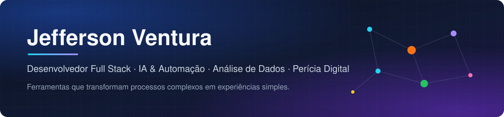

## 👋 Sobre mim

Desenvolvo soluções completas que transformam processos complexos em ferramentas simples, rápidas e confiáveis. Meu trabalho combina **desenvolvimento de software**, **inteligência artificial**, **automação** e **perícia digital**, com foco em quem usa a ferramenta no dia a dia.

| | Área | O que faço |
|:-:|---|---|
| 🤖 | **Inteligência Artificial** | Agentes inteligentes e sistemas autônomos com validação humana |
| ⚙️ | **Automação** | Robôs, automação de navegador, integrações e RPA |
| 🔍 | **Perícia Digital** | Ferramentas de apoio à análise forense e à investigação de dados |
| 📊 | **Dados** | Análise, visualização, grafos de vínculos, linhas do tempo e mapas |
| 💻 | **Desenvolvimento** | Aplicativos desktop, sistemas web e APIs |

---

## 🧰 Ferramentas em destaque

Algumas das ferramentas que desenvolvi, prontas ou em desenvolvimento. Os nomes dos repositórios e a tecnologia de cada uma ficam de fora; o foco aqui é o que elas resolvem.

> [!NOTE]
> Todas as telas abaixo usam **dados fictícios**, criados só para estas capturas. Nenhuma informação real aparece nas imagens.

| Ferramenta | Em uma frase |
|---|---|
| [**ARGOS**](#argos) | Agentes de IA que apoiam a análise investigativa, com validação humana de cada achado |
| [**WRA — WhatsApp Records Analyzer**](#wra) | Extração e análise dos registros entregues pela plataforma WhatsApp Records |
| [**IPED Manager**](#iped-manager) | Fila de indexação de evidências digitais, com acompanhamento ao vivo |
| [**Step Navigator**](#step-navigator) | Navegador de automação: passos reproduzíveis, montados direto na página |
| [**Gerenciador de Processos**](#gerenciador-de-processos) | O que está rodando no Windows, quem iniciou e quanto consome |
| [**USB Identifier**](#usb-identifier) | Descobre a versão real de cada porta USB e o que está ligado nela |
| [**ScreenShare**](#screenshare) | Capturas de tela com editor embutido e envio direto ao Google Drive |
| [**ZoomScreen**](#zoomscreen) | Zoom, desenho, gravação e roteiros digitados para apresentações ao vivo |
| [**Copicola**](#copicola) | Histórico da área de transferência e expansão de texto em qualquer programa |

---

### 🛰️ ARGOS

**Agente de Reconhecimento, Gestão e Organização de Sinais.** Uma estação de trabalho forense em que agentes de IA especializados consultam o acervo indexado no IPED, organizam os resultados e propõem achados. Cada achado é classificado como **fato, inferência ou hipótese**, aponta para a evidência de origem e só entra no relatório depois de **validado pelo analista**. A IA ajuda; quem decide é o analista.

- Grade de dados que continua fluida com 100 mil linhas, com filtros e inspetor de itens
- Grafo de vínculos, quadro de análise com sugestões dos agentes, linha do tempo e mapa
- Pedidos de aprovação em tempo real: nada é gravado sem a decisão do analista
- Relatório montado só com achados validados, com trilha de auditoria verificável

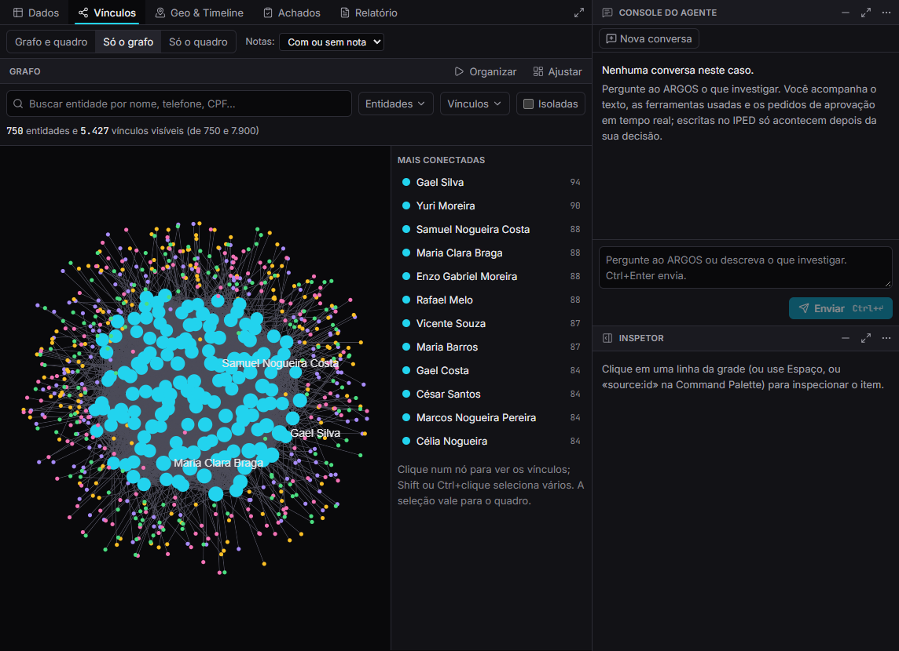

<b>Mais telas</b>

 
<table>
  <tr>
    <td width="50%">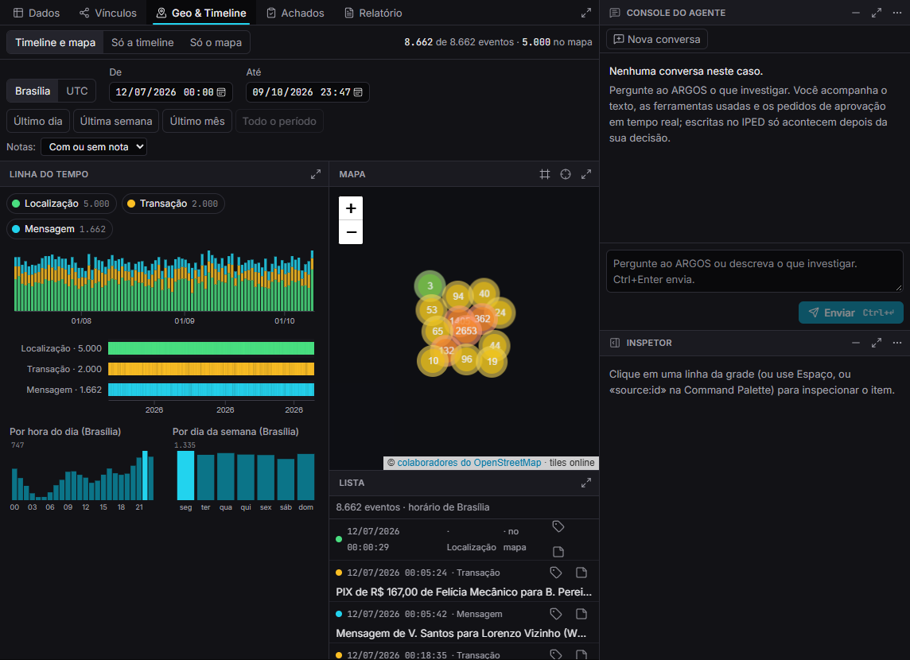</td>
    <td width="50%">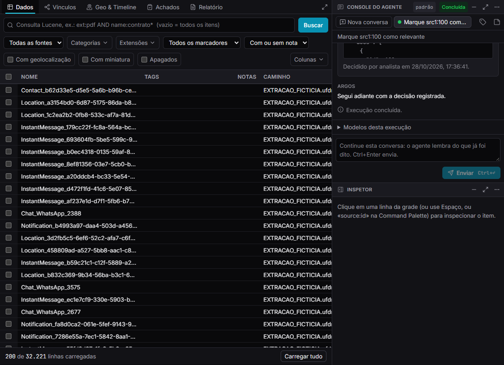</td>
  </tr>
  <tr>
    <td align="center">Linha do tempo e mapa</td>
    <td align="center">Grade de dados e decisão do analista no console</td>
  </tr>
</table>

---

### 💬 WRA — WhatsApp Records Analyzer

Ferramenta de uso restrito para **extrair e analisar** os arquivos entregues pela plataforma WhatsApp Records (grupos, interceptação e registros). Reúne tudo de uma operação num só lugar e transforma milhares de registros em visões que respondem perguntas.

- Dashboard da operação: volume diário por conta, tipos de mensagem, dispositivos e principais interlocutores
- Mensagens, chamadas, contatos em comum, grupos e participantes
- Análise de IPs com geolocalização, análise de horários noturnos e linha do tempo
- Grafo de vínculos entre contas, grupos e IPs compartilhados, com caminho mais curto entre dois números
- Controle de acesso por perfil e trilha de auditoria

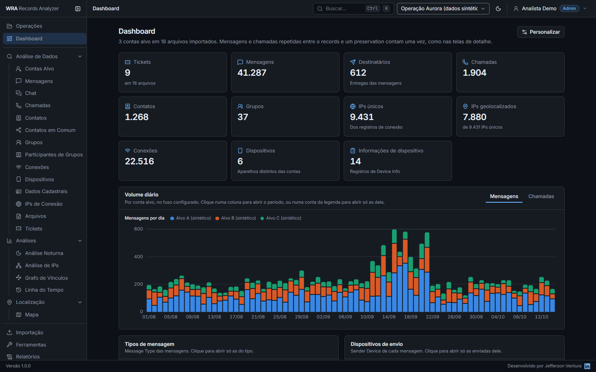

<b>Mais telas</b>

 

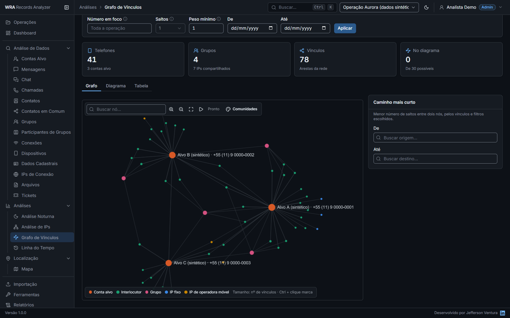

Grafo de vínculos entre contas alvo, interlocutores, grupos e IPs

---

### 🗂️ IPED Manager

Gerenciador da **fila de indexação** do IPED (Indexador e Processador de Evidências Digitais). Organiza operações e coletas, monta os comandos a partir de modelos, executa a fila respeitando o paralelismo configurado e mostra a saída de cada processamento ao vivo.

- Dashboard com espaço em disco, indexações por status, volume e tempo processados
- Fila com reordenação por arrastar, atraso programado, cancelamento e reprocessamento
- Saída do terminal em tempo real e log completo de cada execução
- Destinos pós-processamento (copiar, mover ou manter) e notificações de status

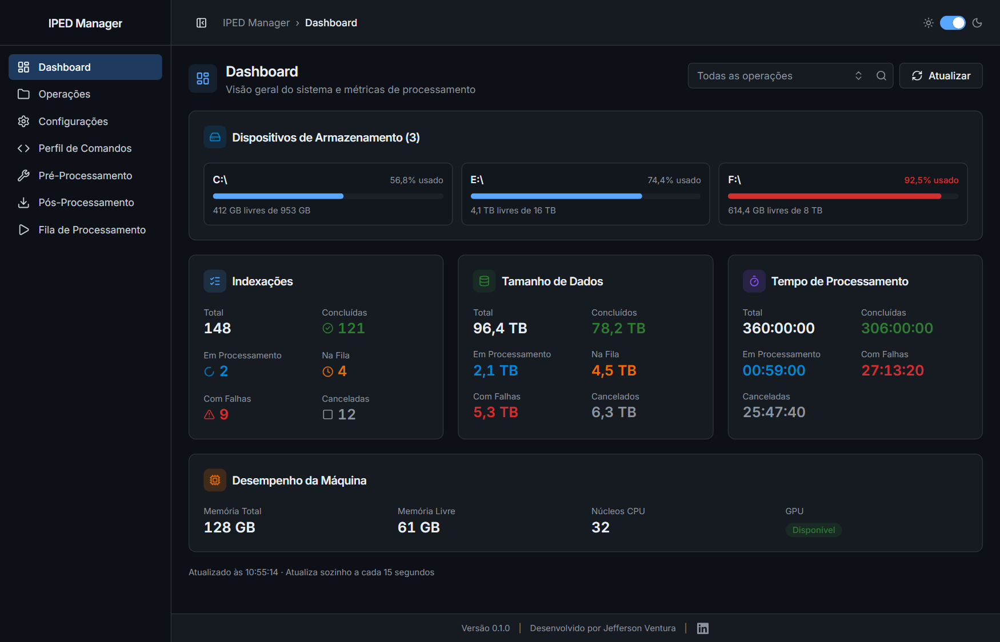

<b>Mais telas</b>

 
<table>
  <tr>
    <td width="50%">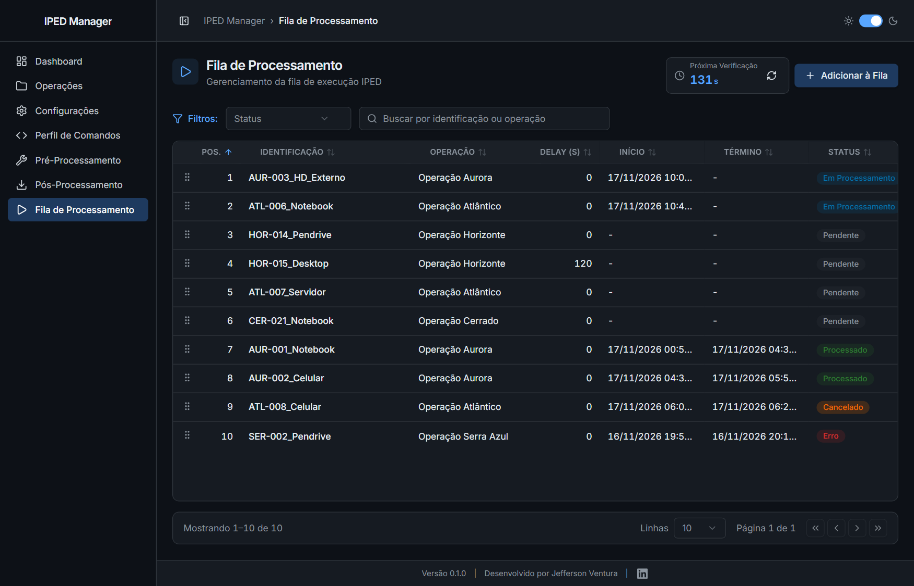</td>
    <td width="50%">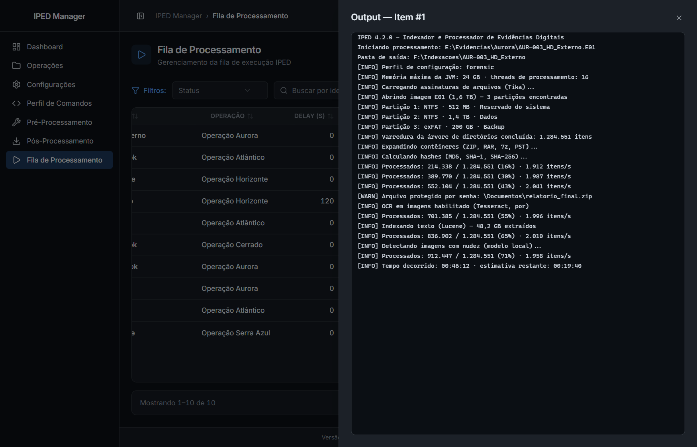</td>
  </tr>
  <tr>
    <td align="center">Fila de processamento</td>
    <td align="center">Saída do processamento ao vivo</td>
  </tr>
</table>

---

### 🧭 Step Navigator

Navegador de automação para montar **passos reproduzíveis**: abrir páginas, escolher elementos direto na tela, preencher, extrair, decidir e repetir. As automações podem ser agendadas, acionadas por um bot do Telegram, conversar com endpoints e pedir ajuda a modelos de IA.

- Editor em lista ou em fluxo visual, com formulário de cada passo ao lado
- Variáveis, tabelas de dados, subautomações e desvios entre passos
- Agendamento, bot do Telegram, endpoints e IA cadastrados uma vez e reaproveitados
- Execução com o mínimo de rastros de automação e licença vinculada à máquina

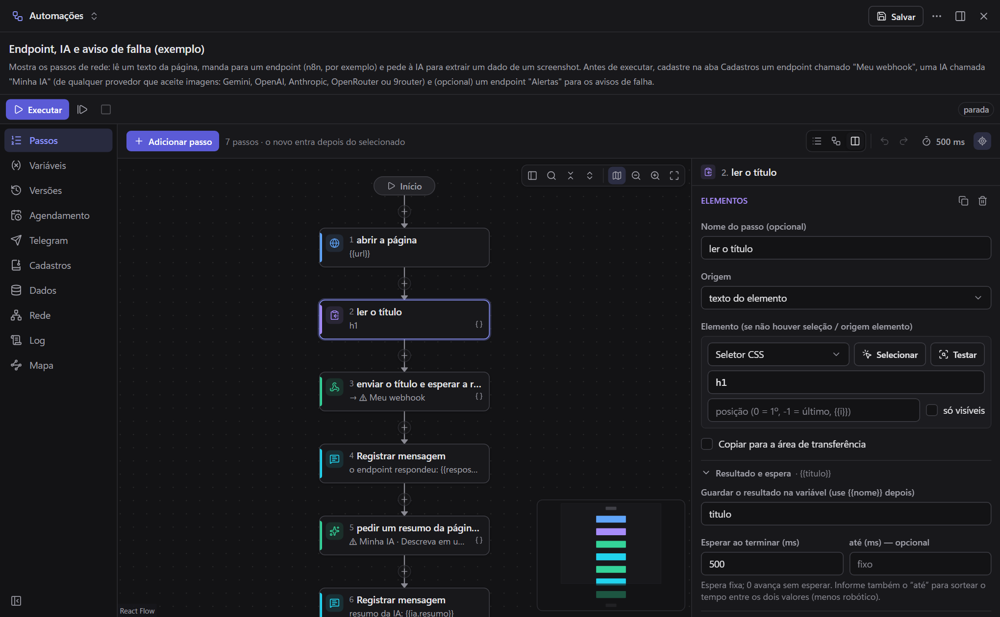

<b>Mais telas</b>

 

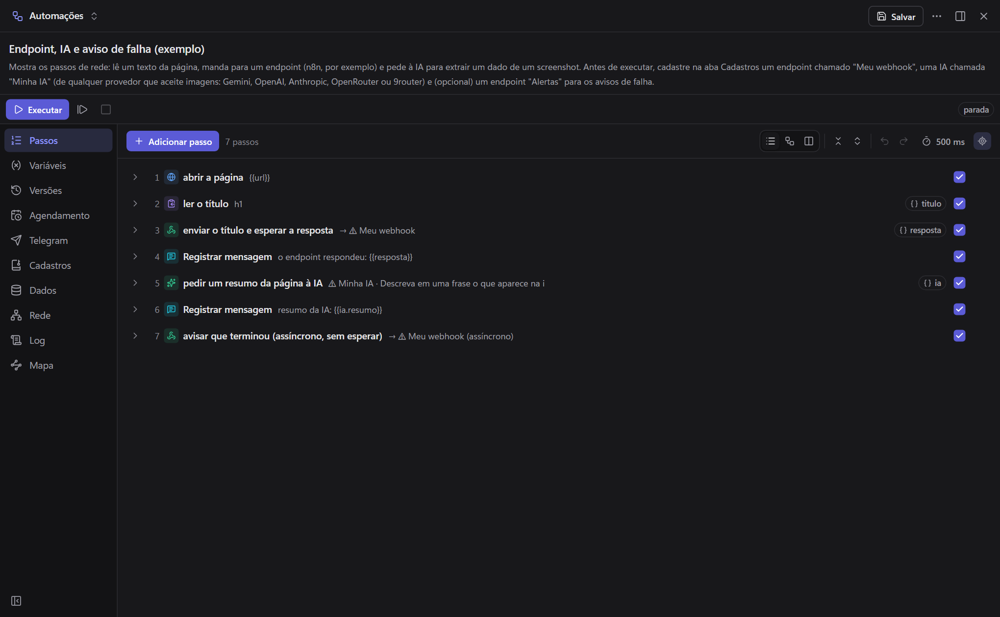

Lista de passos

---

### 📈 Gerenciador de Processos

Monitor de processos para o Windows que vai além do Gerenciador de Tarefas: mostra **quando e por quem** cada processo foi iniciado, de onde ele veio (sistema, serviço, inicialização, tarefa agendada) e quanto de CPU, memória, GPU, disco e rede ele usa.

- Visão geral com CPU por núcleo, memória, GPU, discos e internet Wi‑Fi × cabo
- Árvore de processos e linhagem de quem iniciou cada um
- Tudo o que inicia com o Windows: registro, pastas, tarefas agendadas e serviços
- Verificação de executáveis no VirusTotal e bloqueio contra encerrar processos essenciais

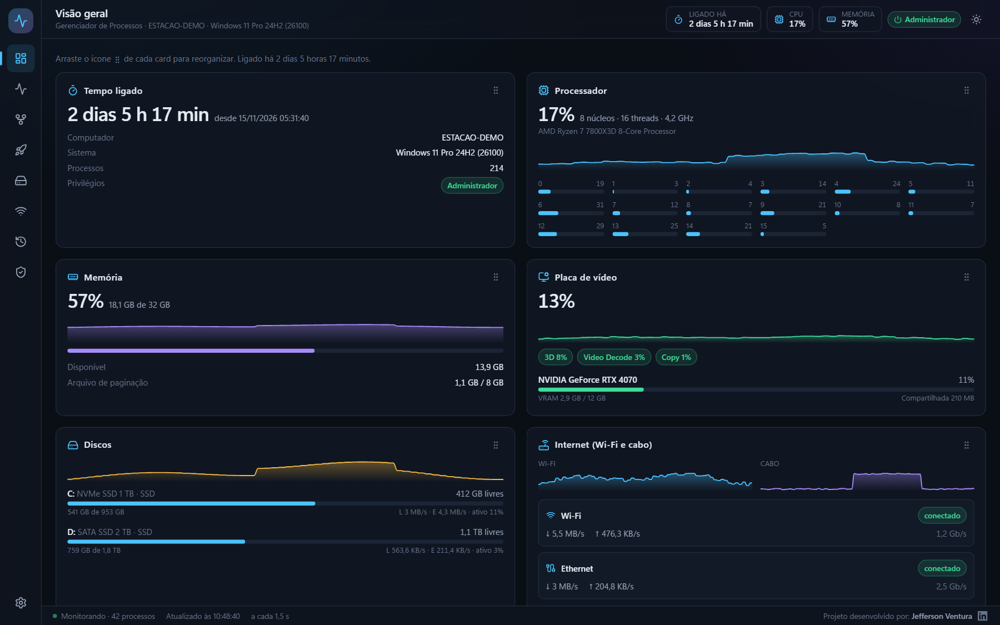

<b>Mais telas</b>

 
<table>
  <tr>
    <td width="50%">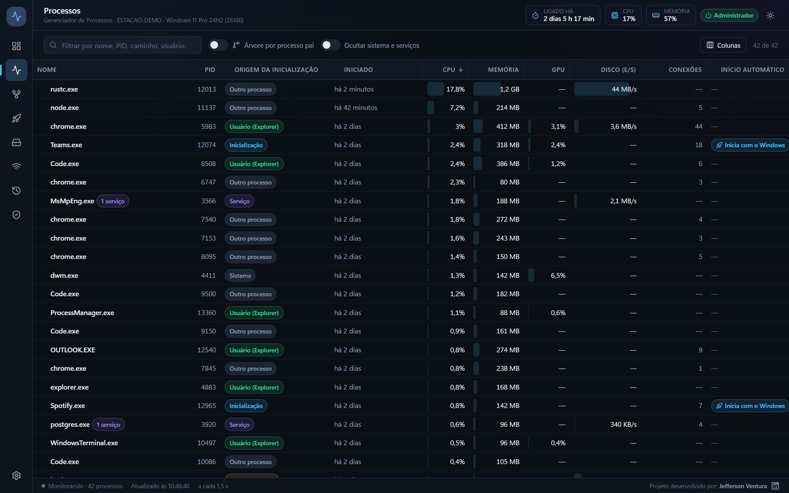</td>
    <td width="50%">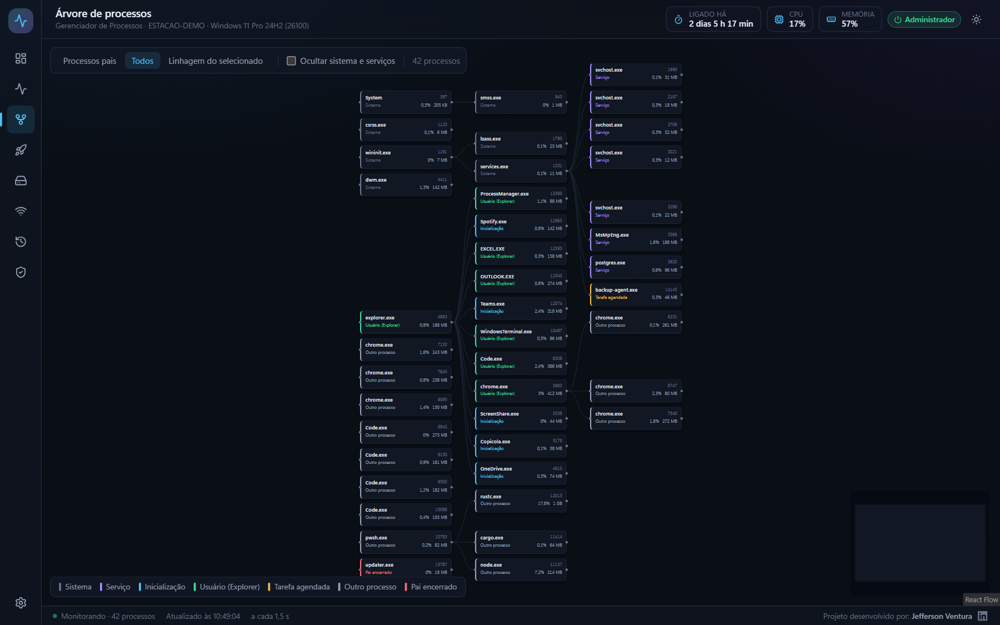</td>
  </tr>
  <tr>
    <td align="center">Processos com origem da inicialização</td>
    <td align="center">Árvore de processos</td>
  </tr>
</table>

---

### 🔌 USB Identifier

Ferramenta portátil que localiza as portas USB do computador, identifica a **versão real de cada uma** (de USB 2.0 a USB4) e mostra o que está ligado em tempo real. Avisa quando um dispositivo trabalha abaixo da capacidade por causa do cabo, do hub ou da porta.

- Painel com as portas agrupadas como estão no gabinete (traseiro, frontal…)
- Assistente que nomeia as portas uma a uma: é só plugar um dispositivo
- Topologia controladora → hubs → portas → dispositivos
- Histórico de conexões e relatórios para exportar, importar e comparar

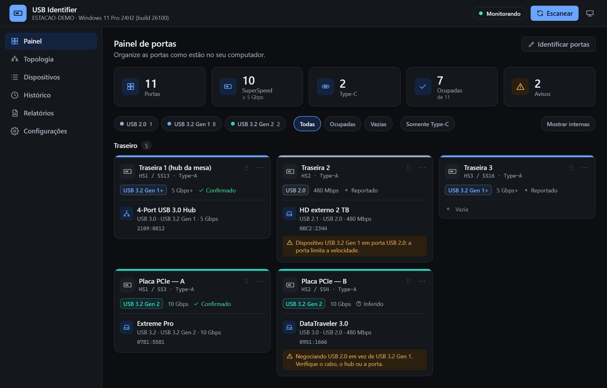

<b>Mais telas</b>

 

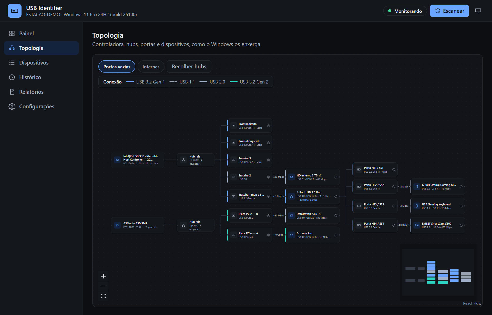

Topologia: controladoras, hubs, portas e dispositivos

---

### 📸 ScreenShare

Capturas de tela **portáteis** com editor embutido e envio direto ao Google Drive, sempre mantendo uma cópia local.

- Captura de região, janela, monitor atual ou todos os monitores, com lupa e medidas
- Setas, formas, textos, passos numerados, marca-texto, destaque e recorte
- Desfoque e pixelização para esconder dados sensíveis
- Reedição não destrutiva: o original e as anotações ficam guardados
- Envio ao Google Drive com escolha de pasta e link copiado automaticamente

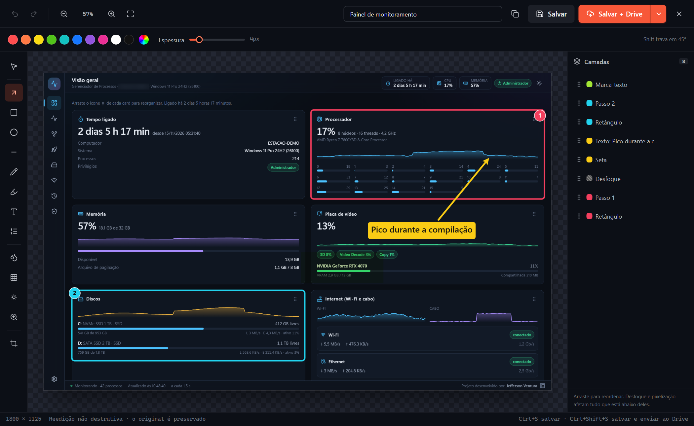

<b>Mais telas</b>

 

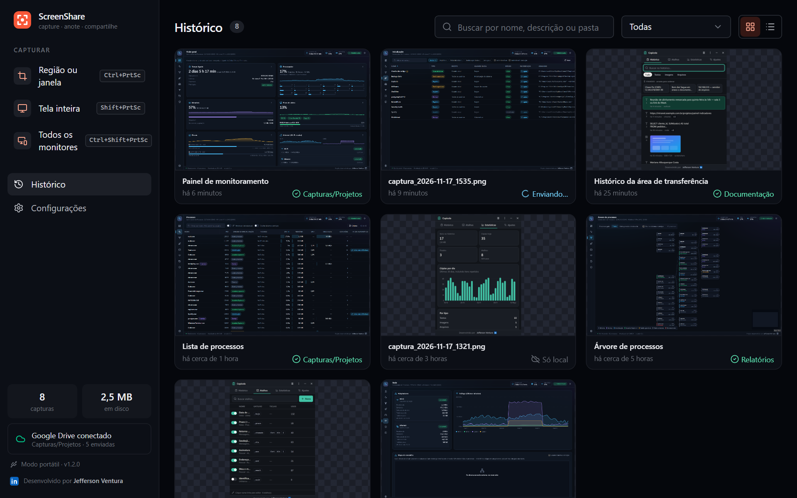

Histórico de capturas com status do envio ao Drive

---

### 🔎 ZoomScreen

Feita para **apresentações e demonstrações ao vivo**: amplia e desenha sobre a tela, grava, recorta com reconhecimento de texto e até digita trechos roteirizados como se fosse ao vivo.

- Zoom com a tela congelada e LiveZoom sobre a tela em movimento
- Desenho por cima de qualquer programa: caneta, linhas, setas, formas, texto e desfoque
- Recorte com OCR, gravação de tela e contagem regressiva para intervalos
- DemoType: roteiros de trechos digitados com um atalho, com pausas e teclas especiais

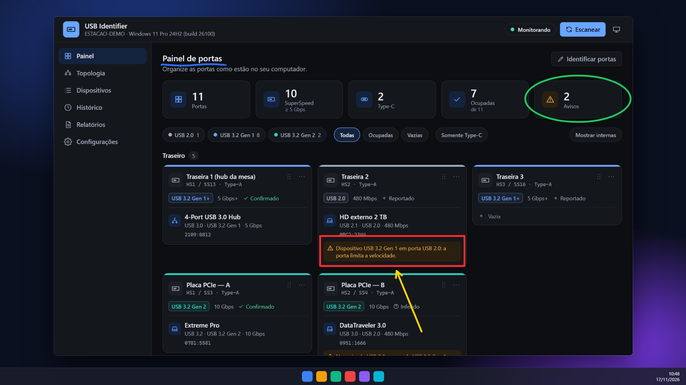

<b>Mais telas</b>

 

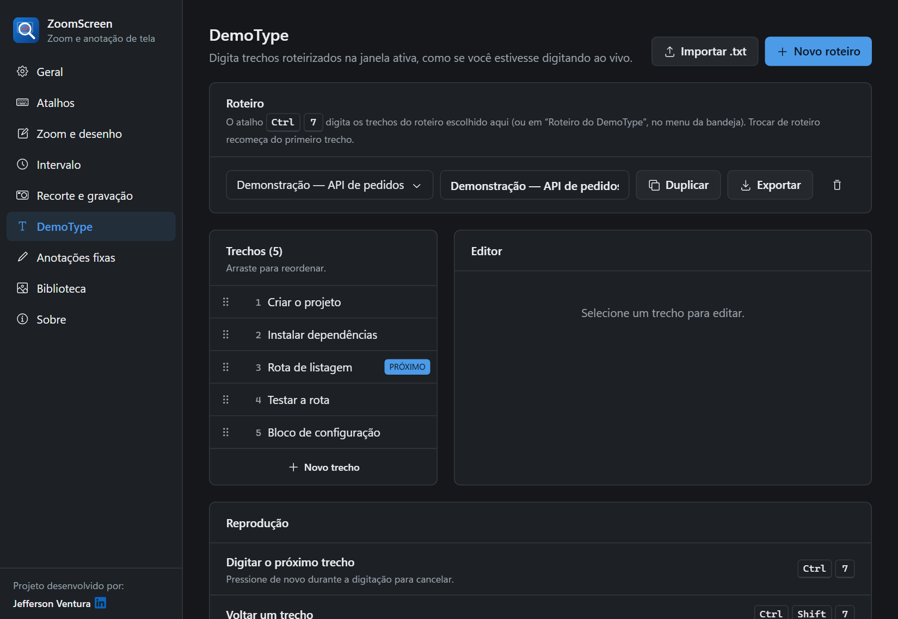

Roteiros do DemoType

---

### 📋 Copicola

Gerenciador do **histórico da área de transferência** com expansão de texto. Um único executável, sem instalação, que funciona 100% offline.

- Guarda textos, imagens e arquivos copiados, sem duplicatas, com busca instantânea
- Itens fixados no topo e colagem rápida pelo teclado
- Atalhos de texto que se expandem em qualquer programa (ex.: `;email`), com variáveis de data e hora
- Respeita conteúdos marcados como privados por gerenciadores de senha
- Estatísticas de uso e backup automático

<table>
  <tr>
    <td width="33%">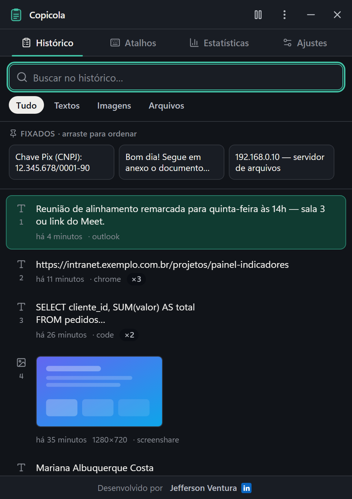</td>
    <td width="33%">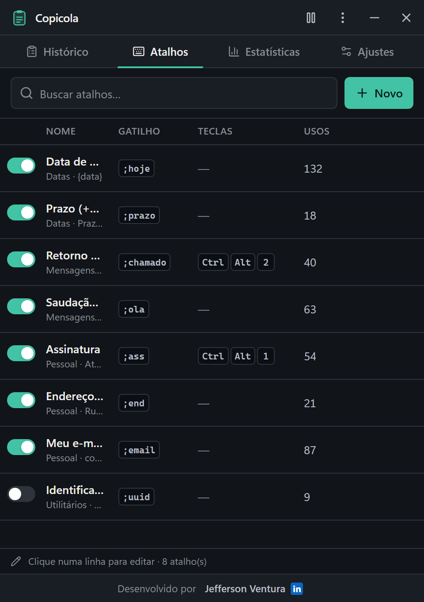</td>
    <td width="33%">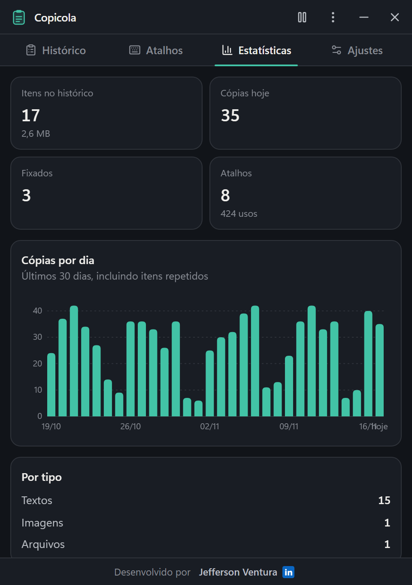</td>
  </tr>
  <tr>
    <td align="center">Histórico</td>
    <td align="center">Atalhos de texto</td>
    <td align="center">Estatísticas</td>
  </tr>
</table>

---

## 🛠️ Stack

<b>Linguagens, frameworks e ferramentas com que trabalho</b>

 

**Linguagens** 

**IA e dados** 

**Frontend e mobile** 

**Backend** 

**Bancos de dados** 

**DevOps e nuvem** 

**Automação e outras ferramentas** 

---

## 📫 Vamos conversar?

Projetos, colaborações ou consultorias: me chame no LinkedIn.

 

*"Transformando ideias em código, dados em insights e processos em automação."*

